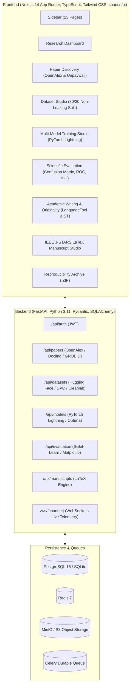

# ResearchOS: Autonomous AI Research Operating System

ResearchOS is a production-quality, full-stack research operating system designed to guide researchers from an initial topic and research question through to an empirically validated, reproducible, publication-ready scientific manuscript (e.g. for **IEEE J-STARS**).

---

## 1. System Architecture



---

## 2. Mandatory GitHub Repository Integrations

| Domain | Open-Source Repository | Integration Role in ResearchOS |
|---|---|---|
| **AI Research & Agents** | [langchain-ai/langgraph](https://github.com/langchain-ai/langgraph) | Multi-agent state machine coordinating literature synthesis, gap analysis, and hypothesis formulation. |
| **Research Outlines** | [stanford-oval/storm](https://github.com/stanford-oval/storm) | Perspective-driven inquiry and structured academic manuscript section generation. |
| **Literature RAG** | [run-llama/llama_index](https://github.com/run-llama/llama_index) | Semantic passage retrieval, claim grounding, and literature comparison matrix. |
| **Paper Discovery** | [ourresearch/openalex-python](https://github.com/ourresearch/openalex-python) | Scholarly search, DOI resolution, author provenance, and citation graphs. |
| **Legal OA Acquisition** | [ourresearch/unpaywall](https://github.com/ourresearch/unpaywall) | Resolves legal, open-access full-text PDFs and author accepted preprints without paywall bypassing. |
| **PDF Extraction** | [docling-project/docling](https://github.com/docling-project/docling) | Deep scientific PDF parsing into structured markdown, equations, and tables. |
| **Bibliographic Parsing** | [kermitt2/grobid](https://github.com/kermitt2/grobid) | TEI-XML extraction of headers, authors, affiliations, and citations. |
| **Dataset Hub** | [huggingface/datasets](https://github.com/huggingface/datasets) | Search, download, and metadata inspection for remote sensing benchmarks. |
| **Data Versioning** | [iterative/dvc](https://github.com/iterative/dvc) | Reproducible dataset hashing, pipeline stage tracking, and manifest generation. |
| **Dataset Inspection** | [voxel51/fiftyone](https://github.com/voxel51/fiftyone) | Visual slice exploration, class distribution auditing, and image quality metrics. |
| **Data Quality** | [cleanlab/cleanlab](https://github.com/cleanlab/cleanlab) | Label issue candidate detection, near-duplicate filtering, and blur auditing. |
| **Model Training** | [Lightning-AI/pytorch-lightning](https://github.com/Lightning-AI/pytorch-lightning) | Scalable multi-model training with early stopping, mixed precision, and checkpointing. |
| **Telemetry & Artifacts** | [clearml/clearml](https://github.com/clearml/clearml) & [mlflow/mlflow](https://github.com/mlflow/mlflow) | Real-time metric logging, parameters tracking, and artifact registry. |
| **Hyperparameter Tuning**| [optuna/optuna](https://github.com/optuna/optuna) | Bayesian hyperparameter optimization (TPE sampler). |
| **Model Evaluation** | [scikit-learn/scikit-learn](https://github.com/scikit-learn/scikit-learn) | Confusion matrices, ROC curves, classification reports, and segmentation metrics (IoU, Dice). |
| **Scientific Diagrams** | [mermaid-js/mermaid](https://github.com/mermaid-js/mermaid) & [xyflow/xyflow](https://github.com/xyflow/xyflow) | Flowcharts, network architectures, and interactive React Flow node graphs. |
| **Academic Style** | [harshaneel/humanize](https://github.com/harshaneel/humanize) & [languagetool-org/languagetool](https://github.com/languagetool-org/languagetool) | Tone adjustment (formal, technical, concise) and academic grammar verification. |
| **Citations** | [zotero/zotero](https://github.com/zotero/zotero) & [citation-js/citation-js](https://github.com/citation-js/citation-js) | BibTeX/RIS formatting, IEEE numbered references, and Crossref DOI verification. |
| **Originality** | [UKPLab/sentence-transformers](https://github.com/UKPLab/sentence-transformers) & [rapidfuzz/RapidFuzz](https://github.com/rapidfuzz/RapidFuzz) | Lexical and semantic overlap verification against project literature library. |

---

## 3. Strict Scientific Rules Enforced

1. **Default 80/20 Non-Leaking Partitioning**:
   - The default dataset split is **80% training and 20% testing**.
   - No separate validation partition is carved out from the test distribution.
   - All validation tuning (early stopping, hyperparameter search) is restricted strictly to cross-validation within the 80% training set.
   - The held-out 20% test set is never evaluated during model development.
2. **Empirical Integrity**:
   - No fabricated benchmarks or invented metrics.
   - All metrics in tables and figures stem from actual model execution on the held-out test partition.
3. **Legal Compliance**:
   - Zero paywall or DRM bypassing.
   - Unpaywall is used solely for legal open-access full-text retrieval, with manual upload for legally acquired institutional copies.

---

## 4. 23 Professional Website Pages

1. **Dashboard** (`/dashboard`): Research KPIs, pipeline progress, and benchmark highlights.
2. **New Research Project** (`/projects/new`): Topic initialization, research questions, and journal target.
3. **Paper Discovery** (`/papers/discover`): OpenAlex scholarly search with Unpaywall OA resolution.
4. **Research Library** (`/library`): Literature library with Docling and GROBID parsing status.
5. **PDF Reader** (`/papers/reader`): Split-view reader with Docling structured section and claim extraction.
6. **Literature Review** (`/literature-review`): Literature comparison matrix comparing methods, datasets, and gaps.
7. **Research Gap Analysis** (`/research-gaps`): LangGraph & STORM multi-agent gap analysis and novelty hypotheses.
8. **Dataset Discovery** (`/datasets/discover`): Hugging Face Hub and Zenodo search with dataset dimensions.
9. **Dataset Processing Studio** (`/datasets/processing`): Resizing, augmentation, and strict 80/20 non-leaking partition generation.
10. **Dataset Explorer** (`/datasets/explorer`): FiftyOne & Cleanlab quality inspection and multitemporal image pair viewer.
11. **Model Library** (`/models/library`): Model families (Siamese U-Net, ResNet-50, Swin Transformer, U-Net, MobileNetV3).
12. **Model Architecture Editor** (`/models/editor`): React Flow node-based visual topological editor for neural layers.
13. **Code Editor** (`/code-editor`): Monaco Editor with sandboxed Python/PyTorch runtime and AI assistant.
14. **Training Studio** (`/training`): PyTorch Lightning multi-model training with live WebSockets progress.
15. **Experiment Tracking** (`/experiments`): MLflow & ClearML runs, parameters, metrics, and checkpoint artifacts.
16. **Results & Visualizations** (`/results`): Confusion matrices, ROC curves, IoU/Dice, and multi-model leaderboard.
17. **Scientific Diagram Generator** (`/diagrams`): Editable Mermaid and SVG/PDF methodology flowcharts.
18. **Academic Writing Studio** (`/writing`): LanguageTool grammar check and tone refinement (formal, technical, concise).
19. **Reference Manager** (`/references`): IEEE numbered references, BibTeX/RIS export, and Crossref DOI verification.
20. **Originality Checker** (`/originality`): Sentence-Transformers semantic scan for unattributed copying.
21. **Journal Submission Studio** (`/journal`): IEEE J-STARS two-column LaTeX preview and pdflatex compiler.
22. **Project Export Center** (`/export`): Complete self-contained reproducibility bundle (.ZIP) with DVC hashes.
23. **Settings & Integrations** (`/settings`): API keys, MinIO S3 buckets, and repository health status.

---

## 5. Windows Development & Setup Instructions

### Prerequisites
- **Node.js**: v18.0.0 or higher
- **Python**: v3.11 or higher
- **Docker & Docker Compose** (Optional, for full stack services)

### Quick Start (Local Windows Mode without Docker)

#### Step 1: Start Backend
```powershell
cd c:\Users\dhanu\OneDrive\Desktop\paperr\backend

# Create and activate virtual environment
python -m venv venv
.\venv\Scripts\Activate.ps1

# Install requirements
pip install -r requirements.txt

# Run FastAPI backend with Uvicorn
uvicorn app.main:app --reload --port 8000
```
*The backend automatically initializes local SQLite persistence if PostgreSQL is not running.*

#### Step 2: Start Frontend
```powershell
cd c:\Users\dhanu\OneDrive\Desktop\paperr\frontend

# Install node dependencies
npm install

# Launch Next.js dev server
npm run dev
```

Open your browser at **`http://localhost:3000`** to access the complete ResearchOS dashboard.

### Running with Docker Compose (Full Production Stack)
```powershell
cd c:\Users\dhanu\OneDrive\Desktop\paperr

# Start PostgreSQL, Redis, MinIO, GROBID, FastAPI, and Next.js
docker compose up -d
```

### Running Backend Automated Tests
```powershell
cd c:\Users\dhanu\OneDrive\Desktop\paperr\backend
pytest tests/ -v
```

